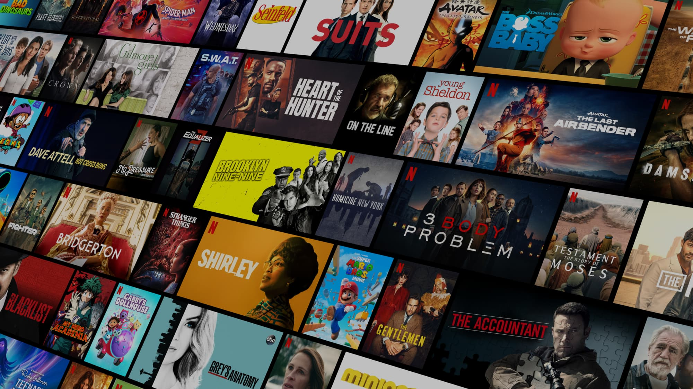
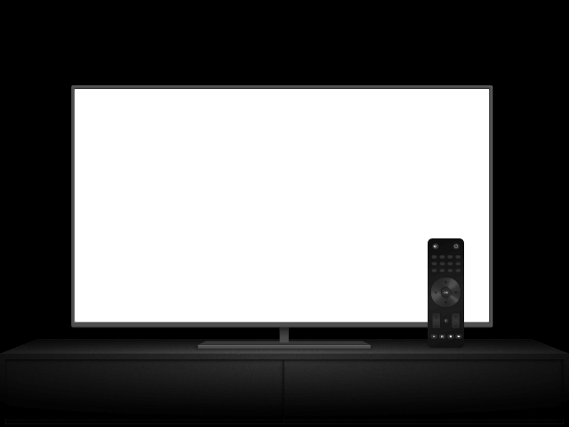
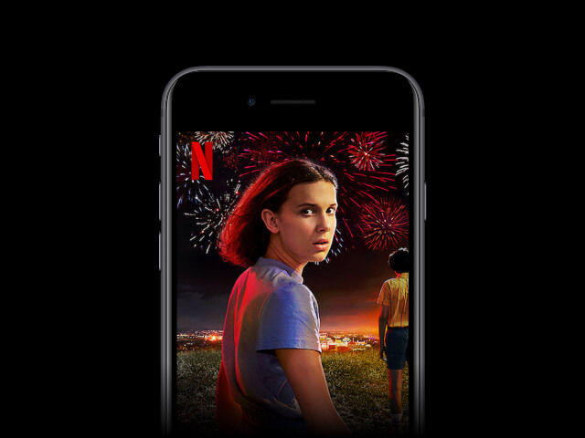

<div align="center">


# Netflix Clone 🎬

**A pixel-inspired, fully responsive Netflix landing page &amp; sign-in page clone built with pure HTML, CSS and vanilla JavaScript — no frameworks, no build step.**

[](https://developer.mozilla.org/docs/Web/HTML)
[](https://developer.mozilla.org/docs/Web/CSS)
[](https://developer.mozilla.org/docs/Web/JavaScript)
[](https://ritamnaskar11.github.io/FUTURE_FS_03.github.io/)

[](https://ritamnaskar11.github.io/FUTURE_FS_03.github.io/)
[](https://ritamnaskar11.github.io/FUTURE_FS_03.github.io/sign.html)

</div>

---

## 📸 Preview

<div align="center">



*Hero section — the poster-wall background (`background_img.jpg`) sitting behind the hero copy.*

<table>
  <tr>
    <th align="center">Landing hero<br /><sub><code>index.html</code></sub></th>
    <th align="center">“Enjoy on your TV”<br /><sub>frame + embedded video</sub></th>
    <th align="center">“Download your shows”<br /><sub>phone artwork</sub></th>
  </tr>
  <tr>
    <td align="center">
      
    </td>
    <td align="center">
      
    </td>
    <td align="center">
      
    </td>
  </tr>
</table>


*<code>netflix.png</code> — the red “N” mark, used as the browser tab icon on both pages.*

> The sign-in page (`sign.html`) reuses the same `background_img.jpg` poster wall, dimmed by a full-height black overlay.

</div>

---

## 🔗 Live Demo

| Page | URL |
| --- | --- |
| 🏠 Landing page | https://ritamnaskar11.github.io/FUTURE_FS_03.github.io/ |
| 🔐 Sign-in page | https://ritamnaskar11.github.io/FUTURE_FS_03.github.io/sign.html |

> The site is served straight from the `main` branch root via **GitHub Pages**, so `index.html` is the entry point.

---

## ✨ Features

### Landing page (`index.html`)

- **Cinematic hero** — full-viewport background image (`assest/images/background_img.jpg`) with a `100vh` black overlay (`opacity: 0.64`) so the text stays readable.
- **Sticky-style navbar** — Netflix wordmark (SVG), a **language selector** button with a globe icon, and a red **Sign In** button that routes to `sign.html`.
- **Email capture CTA** — “Ready to watch? Enter your email…” input + **Get Started ›** button.
- **Ad-plan promo card** — gradient banner (“The Netflix you love for just $1.70”) with a popcorn illustration.
- **Four feature sections**, each on the classic Netflix two-column layout (see table below).
- **FAQ accordion** — 7 questions; clicking a row toggles an `active` class (see the JS below) which expands the hidden answer block.
- **Multi-column footer** — 4-column CSS grid of external links (FAQ, Help Center, Account, Media Center, Speed Test, Privacy, …).
- **Section dividers** — the signature grey `.line` separators between blocks.

#### Feature sections at a glance

| # | Section copy | Media used |
| --- | --- | --- |
| 1 | *Enjoy on your TV* | `tv.png` frame + an auto-playing, muted, looping video embedded inside the TV screen |
| 2 | *Watch everywhere* | `device.png` (laptop) + a looped video playing on the laptop screen |
| 3 | *Create profiles for kids* | `kids.png` illustration |
| 4 | *Download your shows to watch offline* | `mobile.jpg` phone artwork |

### Sign-in page (`sign.html`)

- Dark translucent **card form**: email/phone + password, “Remember me” checkbox, “Forgot password?”, “Sign up now”, and a Google reCAPTCHA note.
- Same navbar branding and its own compact footer with legal links.
- Own responsive rules — the footer collapses to a 2-column grid under `768px`.

### Responsiveness

- A single breakpoint — `@media (max-width: 768px)` — re-flows both pages for mobile:
  - hero shrinks to `60vh`, headline drops to `32px`
  - CTA input/button stack vertically (`flex-direction: column`)
  - `first` / `second` / `third` sections stack with centered text
  - video overlays are re-positioned to stay inside the TV/laptop frames
  - FAQ boxes widen to `74vw` and text drops to `16px`
  - footer grid switches from `4 × 1fr` to `2 × 1fr`

---

## 🧰 Tech Stack

| Layer | Technology | Where it is used |
| --- | --- | --- |
| Markup | **HTML5** | `index.html`, `sign.html` — semantic sections, nav, footer, FAQ blocks |
| Styling | **CSS3** | `style.css` (global) + page-scoped `<style>` inside `sign.html` |
| Layout | **Flexbox & CSS Grid** | `display: flex` for sections/nav, `grid-template-columns: 1fr 1fr 1fr 1fr` for the footer |
| Styling extras | **Gradients, transitions, filters** | promo-card gradient, `transition: transform .3s` on FAQ icons, `filter: invert(1)` for the plus icon |
| Icons / art | **SVG + PNG + JPG** | `assest/images/*` (logo, globe, plus, TV, laptop, kids, phone, popcorn) |
| Media | **HTML5 `<video muted autoplay loop>`** | Netflix sample clips inside the TV and laptop frames |
| Behaviour | **Vanilla JavaScript (ES6)** | `script.js` — FAQ accordion via `classList.toggle()` |
| Fonts | **Google Fonts (`@import`)** | Open Sans, Ubuntu, Aldrich, Michroma, Orbitron, Roboto, and more |
| Hosting | **GitHub Pages** | Auto-deployed from `main` |
| Dependencies | **None** 🎉 | No npm, no bundler, no framework — just open the file |

---

## 📁 Project Structure

```text
FUTURE_FS_03.github.io/
│
├── index.html            # Landing page (hero, features, FAQ, footer)
├── sign.html             # Sign-in page (form + scoped <style> block)
├── style.css             # All shared styling + the 768px media query
├── script.js             # FAQ accordion toggle logic
├── netflix.png           # Red "N" logo / favicon
│
└── assest/               # ⚠️ Note: folder is intentionally named "assest" (matches the code)
    ├── images/
    │   ├── background_img.jpg   # Hero + sign-in page background (2000×1125)
    │   ├── text.svg             # "NETFLIX" wordmark in the navbar
    │   ├── icon.svg             # Globe icon for the language selector
    │   ├── plus.svg             # "+" toggle icon for the FAQ rows
    │   ├── device.png           # Laptop illustration ("Watch everywhere")
    │   ├── mobile.jpg           # Phone artwork ("Download your shows")
    │   ├── kids.png             # Kids illustration ("Create profiles for kids")
    │   ├── popcorn.png          # Popcorn art for the promo card
    │   ├── tv.png               # TV frame with a transparent screen area
    │   ├── img.svg              # Extra illustration asset
    │   └── symbol.svg           # Extra icon asset
    └── videos/
        ├── video.m4v
        └── Screen Recording 2025-09-02 195359 (online-video-cutter.com).mp4
```

> 💡 The `assest` folder name (a typo of `assets`) is **referenced throughout the HTML**, so keep it as-is unless you rename it everywhere.

---

## 🚀 Getting Started

### 1. Clone the repository

```bash
git clone https://github.com/RitamNaskar11/FUTURE_FS_03.github.io.git
cd FUTURE_FS_03.github.io
```

### 2. Run it

There is **no install or build step**. Pick any of these:

| Option | How |
| --- | --- |
| **Simplest** | Double-click `index.html` — it opens in your browser |
| **Recommended** | Open the folder in VS Code → install the **Live Server** extension → right-click `index.html` → *Open with Live Server* |
| **Python** | `python -m http.server 5500` → visit `http://localhost:5500` |
| **Node** | `npx serve .` |

> 🌐 **Internet is required** for two things: the Google Fonts `@import` in `style.css`, and the two feature videos, which are streamed from `web.archive.org` copies of Netflix's CDN assets. Everything else is local.

---

## 🧠 How the FAQ Accordion Works

`script.js` grabs every `.faqbox`, listens for a click, and toggles an `.active` class. `style.css` then reveals the answer:

```js
// script.js
const faqs = document.querySelectorAll(".faqbox");

faqs.forEach(faq => {
  faq.addEventListener("click", () => {
    faq.classList.toggle("active");
  });
});
```

```css
/* style.css */
.faq-answer {
    display: none;
}

.faqbox.active .faq-answer {
    display: block;
}
```

No library needed — five lines of CSS plus a `classList.toggle()` gives the full accordion behaviour.

---

## 📱 Responsive Breakpoints

| Viewport | Behaviour |
| --- | --- |
| `> 768px` (desktop / tablet) | Two-column feature sections, `4 × 1fr` footer grid, `48px` hero headline, side-by-side email input & button |
| `≤ 768px` (mobile) | Stacked columns, `2 × 1fr` footer grid, `32px` hero headline, full-width stacked CTA, hero reduced to `60vh` |

---

## 🗺️ Roadmap / Known Issues

Small, honest notes for anyone extending the project:

- [ ] **Folder typo** — `assest/` should ideally be `assets/` (requires updating every `src` in both HTML files).
- [ ] **`<style>` placement in `sign.html`** — the page-scoped stylesheet sits *after* `</head>`. It works, but moving it into `<head>` (or into `style.css`) would be cleaner.
- [ ] **Stray character** — `sign.html` contains a leftover `]` right before the commented-out Sign In button.
- [ ] **Sign-in form is UI-only** — submitting does not authenticate or persist anything; there is no backend.
- [ ] **Debug log** — `script.js` starts with `console.log("Flix");` which can be removed for production.
- [ ] **Images could be optimised** — `popcorn.png` and `background_img.jpg` are large; converting to WebP would speed up first paint.
- [ ] **Add a `LICENSE` file** — none exists yet in the repository.
- [ ] **Accessibility polish** — decorative `` tags use empty `alt=""`; interactive FAQ rows would benefit from `aria-expanded` and keyboard support.
- [ ] **Extras** — a hero trailer autoplay, a working language dropdown, and a real FAQ search would round out the clone nicely.

---

## ⚠️ Disclaimer

This project is a **front-end clone created purely for learning and educational purposes** (as part of the `FUTURE_FS_03` internship task repo). It is **not affiliated with, endorsed by, or connected to Netflix, Inc.** in any way.

- "Netflix", the Netflix logo, poster artwork, and the sample streaming clips are **trademarks and copyrights of Netflix, Inc.**
- All product names, logos, and brands are property of their respective owners.
- No commercial use is intended; no user data is collected, stored, or transmitted.

---

## 👨‍💻 Author

<div align="center">

**Ritam Naskar**

[](https://github.com/RitamNaskar11)
[](https://github.com/RitamNaskar11/FUTURE_FS_03.github.io)

</div>

---

## 🙌 Acknowledgements

- **Netflix** — for the original design that inspired this layout study.
- **Google Fonts** — Open Sans, Ubuntu, and friends.
- **Internet Archive / Wayback Machine** — for keeping the sample feature videos available.
- **GitHub Pages** — for free static hosting.

---

<div align="center">

### ⭐ If you found this project helpful, consider giving it a star!

Made with ❤️, ☕ and a lot of CSS.

</div>